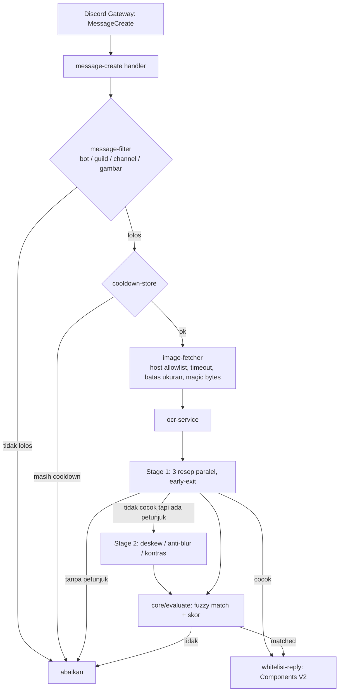

# Arsitektur

## Prinsip

1. **Berlapis**: `config` → `core` (murni) → `services` → `discord` (adapter) → `app` (perakit).
2. **Tanpa side effect saat import.** Pool OCR, client Discord, dan logger dibuat lewat factory dan dirakit satu kali di `src/app.ts`.
3. **Fail-fast config.** Konfigurasi salah menghentikan proses dengan pesan yang menyebut variabelnya.
4. **Logika inti murni.** `src/core` tidak menyentuh jaringan, disk, atau Discord, sehingga mudah diuji.
5. **Handler tipis.** Event Discord hanya mengorkestrasi service.

## Alur data

## Modul

| Modul                                 | Tanggung jawab                                                                        |
| ------------------------------------- | ------------------------------------------------------------------------------------- |
| `config/env.ts`                       | Skema zod untuk environment; `parseEnv()` melempar `ConfigError` berisi semua masalah |
| `config/signals.ts`                   | Memuat dan memvalidasi `config/signals.json` (nama unik, `minScore` bisa dicapai)     |
| `core/text`                           | `normalize` (hanya a–z) dan `fuzzyIncludes` (algoritma Sellers)                       |
| `core/detection`                      | `evaluate` (skor sinyal + sinyal wajib), `hasHint` (gerbang stage 2)                  |
| `services/ocr/worker-pool.ts`         | Pool worker Tesseract per PSM; `init`, `run`, `shutdown`                              |
| `services/ocr/recipes.ts`             | Resep preprocessing `sharp` sebagai data (STAGE1, STAGE2)                             |
| `services/ocr/stage-runner.ts`        | Konkurensi terbatas, early-exit, timeout per resep, error dicatat (tidak ditelan)     |
| `services/ocr/ocr-service.ts`         | `analyze`, `warmup`, `shutdown`                                                       |
| `services/image/image-fetcher.ts`     | Unduh aman                                                                            |
| `services/cooldown/cooldown-store.ts` | Cooldown in-memory dengan eviction otomatis; antarmuka kecil agar bisa diganti Redis  |
| `discord/*`                           | Client, filter, handler, builder balasan                                              |
| `shared/*`                            | Logger (pino, redaksi token), error, konstanta, heartbeat                             |

## Siklus hidup

`main.ts` → `loadConfig()` → `createLogger()` → `createApp()` → `start()`:
warmup OCR → login Discord → heartbeat. `SIGINT`/`SIGTERM` → `stop()`:
hentikan heartbeat → `client.destroy()` → terminate semua worker Tesseract → `exit(0)`.
Kegagalan tak tertangani (`unhandledRejection`, `uncaughtException`) dicatat lalu proses keluar dengan kode 1.
